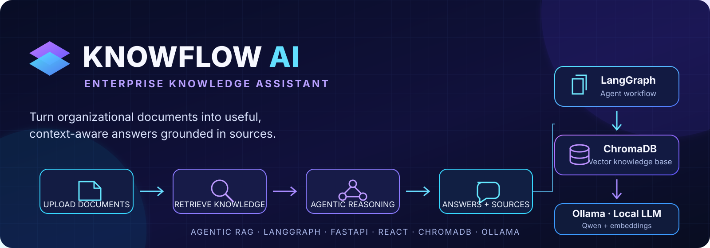
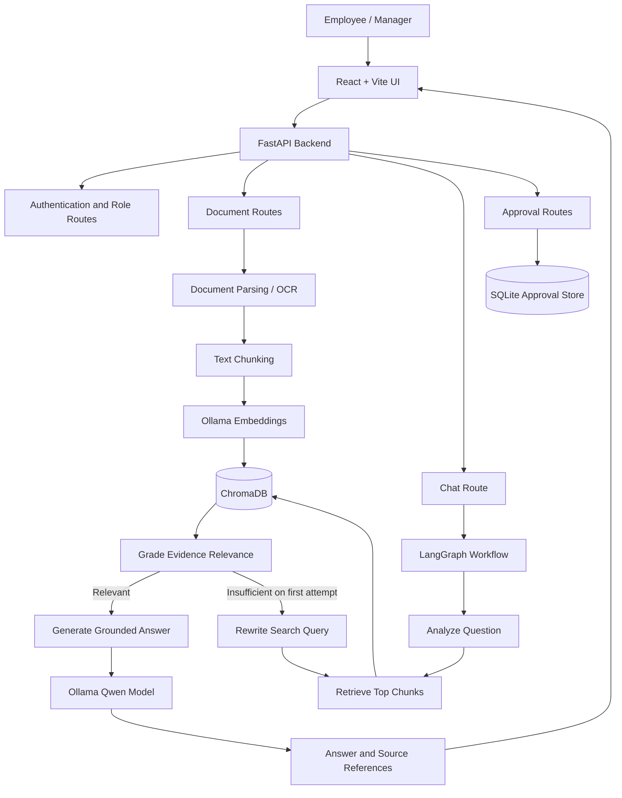

<p align="center">
  
</p>

# KnowFlow AI

**Enterprise Knowledge Assistant with Agentic RAG**

KnowFlow AI is a local-first knowledge assistant that ingests organizational documents, indexes content in ChromaDB, retrieves relevant passages, and generates evidence-grounded answers using locally hosted Ollama models. It also includes employee/manager role flows and a manager-reviewed approval-request workflow.

[](https://www.python.org/) [](https://react.dev/) [](https://fastapi.tiangolo.com/) [](https://www.langchain.com/langgraph) [](https://www.trychroma.com/) [](https://ollama.com/)

**Repository:** https://github.com/abinayanehru/KnowFlow-AI  
**Version:** 1.1.0 · **Status:** Local development/demo project

> Core features were manually tested by the project owner in the local development environment. This is not a production-security certification.

## Overview

Users ask questions through a React chat interface and receive answers based on retrieved document context. LangGraph coordinates query analysis, vector retrieval, evidence grading, an optional single query-rewrite retry, and answer generation when evidence is judged sufficient.

## Features

- **Agentic RAG:** LangGraph coordinates query analysis, retrieval, evidence grading, one search-query rewrite when needed, and answer generation.
- **Evidence-grounded responses:** The answer prompt instructs the model to use retrieved evidence only; when evidence is insufficient, the workflow withholds an answer.
- **Source references:** Filenames and source locations such as PDF pages, spreadsheet sheets, presentation slides, or document sections where available.
- **Multi-format ingestion:** PDF, DOCX, TXT, Markdown, CSV, XLSX, PPTX, HTML, JPG, JPEG, and PNG.
- **Image OCR:** Tesseract OCR through pytesseract for supported image uploads.
- **Semantic retrieval:** Ollama nomic-embed-text embeddings stored in persistent ChromaDB.
- **Local LLM:** Ollama qwen2.5:1.5b for answer generation.
- **Document library:** Browse, select, and remove indexed documents; scope chat to one selected file or all uploaded documents.
- **Role-based experience:** Employee and manager dashboards, role switching, and browser session restoration.
- **Approval workflow:** Employees submit requests; managers review, approve, or reject with comments. Self-approval is blocked.

## Technology Stack

| Layer | Technologies |
|---|---|
| Frontend | React, Vite, JavaScript, CSS |
| Backend | Python, FastAPI, Uvicorn |
| Agent orchestration | LangGraph |
| LLM runtime | Ollama |
| Answer model | qwen2.5:1.5b |
| Embedding model | nomic-embed-text |
| Vector database | ChromaDB |
| Approval persistence | SQLite |
| OCR | Tesseract OCR, pytesseract, Pillow |
| Document parsing | PyMuPDF, python-docx, openpyxl, python-pptx, BeautifulSoup |

## Architecture



## How the RAG Flow Works

1. A user uploads a supported document.
2. The backend extracts text; Tesseract OCR handles supported image uploads.
3. Text is divided into chunks, embedded with Ollama, and stored in ChromaDB.
4. The user asks a question, optionally scoped to one selected document.
5. LangGraph retrieves up to five candidate chunks and uses the local model to grade whether the evidence directly answers the question.
6. If evidence is insufficient on the first pass, the query is rewritten and retrieval is attempted once more.
7. The workflow generates an answer from retrieved evidence or withholds it if evidence remains insufficient. Source metadata is returned where available.

## Approval Workflow

- Employees submit approval requests through the application.
- Requests are stored with requester, status, reviewer, comment, and timestamps.
- Managers review pending requests and approve or reject them with an optional comment.
- Employees can view their submitted requests and decision status.
- The backend prevents requesters from approving their own requests.

## Supported File Types

| Category | Formats | Extraction / locator |
|---|---|---|
| PDF | .pdf | PyMuPDF text extraction; page number |
| Word | .docx | Paragraphs and tables; document section |
| Text | .txt, .md | UTF-8 text; text section |
| Spreadsheet | .csv, .xlsx | Rows / worksheet cells; row or sheet |
| Presentation | .pptx | Slide text and tables; slide number |
| Web | .html | BeautifulSoup text extraction |
| Images | .jpg, .jpeg, .png | Tesseract OCR |

**Upload limit:** 15 MB per file. Tesseract must be installed separately for image OCR. The current PDF path extracts embedded text; scanned-PDF OCR is not included.

## Screenshots

Add screenshots captured from your running KnowFlow AI application. Suggested views: Employee dashboard, AI Assistant with a grounded response and source references, Document Library, and Manager Approval Center.

Create a docs/screenshots/ folder and add sanitized images, then use Markdown such as:

```md


```

Do not include confidential documents, tokens, or personal information in screenshots.

## Run Locally on Windows

### Prerequisites

- Python 3.10+ (use a version compatible with the pinned dependencies)
- Node.js and npm
- Ollama installed and running
- Tesseract OCR installed separately for image OCR
- Git

### 1. Pull the local models

```bash
ollama pull qwen2.5:1.5b
ollama pull nomic-embed-text
```

### 2. Set up the backend

From the repository root:

```powershell
cd backend
python -m venv .venv
.\.venv\Scripts\Activate.ps1
python -m pip install --upgrade pip
pip install -r requirements.txt
```

Configure the required environment variables locally, including a unique SECRET_KEY and manager password configuration. Keep .env out of Git.

Ensure Tesseract is installed and discoverable. If it is not on PATH, configure pytesseract.pytesseract.tesseract_cmd in the image-ingestion code to the actual tesseract.exe location.

Start the API:

```powershell
uvicorn app.main:app --reload
```

- Health check: http://127.0.0.1:8000/health
- Interactive API documentation: http://127.0.0.1:8000/docs

### 3. Set up the frontend

Open a second terminal from the repository root:

```powershell
cd frontend
npm install
npm run dev
```

Open the Vite development URL shown in the terminal (normally http://localhost:5173).

### 4. Local model availability

Keep Ollama running on the machine hosting the backend. Ensure the model names match the models pulled above.

## API Overview

Use /docs for exact request schemas and response payloads.

| Method | Endpoint | Purpose |
|---|---|---|
| GET | /health | Health and version |
| POST | /auth/employee | Start an employee session |
| GET | /auth/session | Validate token and return role/user ID |
| POST | /auth/manager | Exchange an authenticated employee session plus manager password for manager session |
| POST | /documents/upload | Upload and index a supported document |
| GET | /documents/count | Return indexed chunk count |
| GET | /documents/list | List indexed documents |
| DELETE | /documents/{filename} | Delete a document and indexed chunks |
| POST | /documents/search | Search indexed chunks |
| POST | /chat/ask | Ask a question against uploaded knowledge |
| POST | /approvals/request | Submit an approval request |
| GET | /approvals/mine | List current employee requests |
| GET | /approvals/pending | List pending manager approvals |
| GET | /approvals/all | List approval requests for manager review |
| POST | /approvals/respond/{request_id} | Approve or reject a request |

## Project Structure

```text
KnowFlow-AI/
├── backend/
│   ├── app/
│   │   ├── agents/
│   │   ├── api/
│   │   ├── generation/
│   │   ├── ingestion/
│   │   ├── retrieval/
│   │   └── security/
│   └── requirements.txt
├── frontend/
│   ├── src/
│   ├── public/
│   └── package.json
├── README.md
├── KnowFlow_AI_Technical_Documentation.md
└── .gitignore
```

## Data, Configuration, and Security Notes

Keep local runtime data and secrets out of the public repository:

- backend/.env — local secrets and manager password configuration.
- backend/chroma_data/ — persistent ChromaDB data.
- backend/approval_requests.sqlite — approval request records.
- backend/approval_checkpoints.sqlite — separate LangGraph checkpoint/demo data, if present.
- .venv/, node_modules/, and generated caches — local development artifacts.

This is a local development/demo configuration, not a hardened production deployment. The current demo uses a shared manager identity (knowflow-manager) and browser/demo-oriented employee sessions. Before real multi-user deployment:

- Replace the shared manager identity with individual accounts and a proper identity provider.
- Add suitable authentication and role/tenant authorization to document upload, list, count, search, and delete routes before exposing the service beyond a trusted local demo.
- Use strong secret management, HTTPS, rate limiting, audit logging, backups, and file-content validation/malware scanning.
- Add tenant-aware document isolation and test cross-user access.
- Treat retrieved documents as untrusted input and protect sensitive source content.

Never commit passwords, tokens, .env, or databases containing real business data.

## Testing

The project owner reported successful local manual testing of:

- Employee and manager login, role switching, and role restoration after refresh.
- Approval submission, manager review, approve/reject, persistence, and self-approval prevention.
- Supported document uploads, including image OCR.
- RAG responses and source references.
- Document management and existing dashboard/chat functionality.

Use non-sensitive sample documents for repeatable checks and verify answers against the original source. Test unauthorized requests and cross-user document access separately before deployment.

## Known Scope and Limitations

- Local development/demo setup; not production-security certified.
- Shared manager identity in the current demo implementation.
- SQLite approval request API and the separate LangGraph checkpoint demonstration are distinct workflows.
- OCR covers supported image uploads; scanned-PDF OCR is not included.
- The configured local Ollama models must be available on the backend host.

## Author

**Abinaya N**  
GitHub: https://github.com/abinayanehru

---

*KnowFlow AI — Turning organizational documents into accessible, evidence-grounded knowledge.*